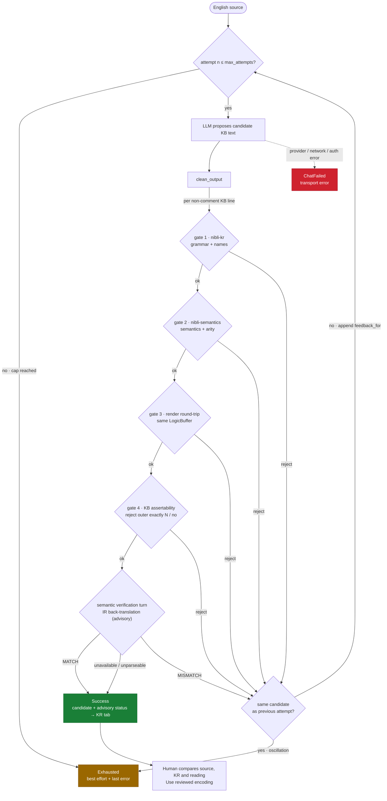

# nibli-formalize

The **agentic English→KB formalizer engine** for the Transparency Triad
(`fanva` = Lojban "translate" — the crate name predates THE FLIP). An LLM
formalizes English into **nibli KR**; the real Nibli compiler verifies every
candidate and feeds deterministic errors back until the KB text is valid.
Surfaced inside `nibli-ui` as **Formalize** mode (this crate holds no UI).
"Formalize", never "compile": the LLM step is interpretive and sits outside
the reasoning firewall, behind the deterministic gates below.

## The loop

Every candidate must clear a four-gate, fail-fast, local firewall:

1. `nibli_kr::parse_checked` — grammar and fail-closed name resolution.
2. `nibli_semantics::compile_from_ast` — semantics and arity.
3. The render round-trip gate — the canonical `nibli_kr::render` re-spelling
   must recompile to the same `LogicBuffer` (pure Rust, native and WASM).
4. The KB-assertability gate — query-only `exactly N` / `no` formulas and
   executable `product` / `sum` / `quotient` atoms in asserted position are
   rejected instead of being presented as persistent constraints, facts, or
   rule literals. Opaque `fact { ... }` / `event { ... }` content remains
   quoted. If an exact source claim cannot be represented by explicit,
   source-supported ordinary facts, it stays an explicit unsupported failure;
   it is never silently omitted, weakened, or fabricated around.

A rejection feeds the gate's own message back through `gates::feedback_for`.
The LLM retries up to `max_attempts`, with an oscillation guard. A gate-clean
candidate then faces the semantic verification turn (`verify.rs`): a fresh
context judge reads the engine's IR-level back-translation of each KB line.
A mismatch retries through the same loop. Every attempt records an advisory
`VerificationStatus`, separately from its deterministic gate result:

| Status | Meaning |
| --- | --- |
| `NotRun` | Local validation failed before semantic verification ran. |
| `Matched` | The verifier returned the exact `MATCH` response. |
| `Mismatched(issues)` | The verifier returned `MISMATCH`; its feedback enters the retry loop. |
| `Unavailable(reason)` | The verifier could not run or its reply was unparseable. A gate-clean draft can still be returned, with this status visible. |

Unavailable verification is never reported as matched. Neither a model's match
judgment nor local validity establishes that a draft captures the intended source.
This check runs before the draft is shown and is separate from the engine's later
nibli-kr → nibli-semantics → nibli-reason execution.

The compiler and round-trip portion is `gates::local_gates`; the full
assertion-authoring contract is `gates::validate` / `gates::validate_kb`.

In `nibli-ui`, custom KB drafts require **Use reviewed encoding** before a query
runs. Review is bound to the exact source and KR, the current edit revision,
engine build and reasoning profile, and lasts only in that tab. An edit requires
fresh review even if the text is later restored. Translated queries have their
own **Use reviewed query** step. Provided examples are labeled as provided and
do not record personal approval. Complete KB admission must succeed before
reasoning; an invalid line cannot leave a partially loaded KB available to query.

## Test discipline

- Native `cargo test -p nibli-formalize --lib` (`just test-formalize`) covers
  local gates, the exact-count assertion guard, provider/agent behavior,
  bounded history, prompt grounding, and the semantic verification turn with
  mocked `chat()`.
- The shipped system prompt's examples and prose snippets are compiled by
  guard tests so prompting guidance cannot silently drift from the grammar.
